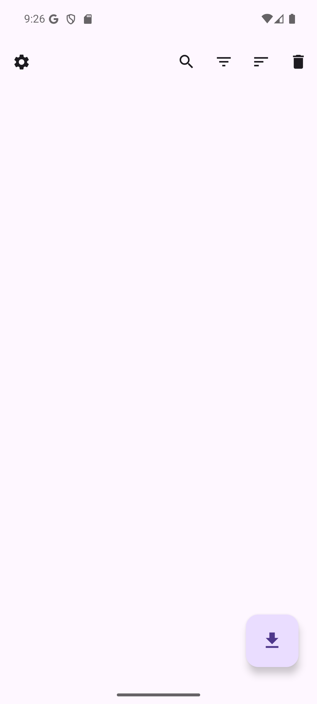
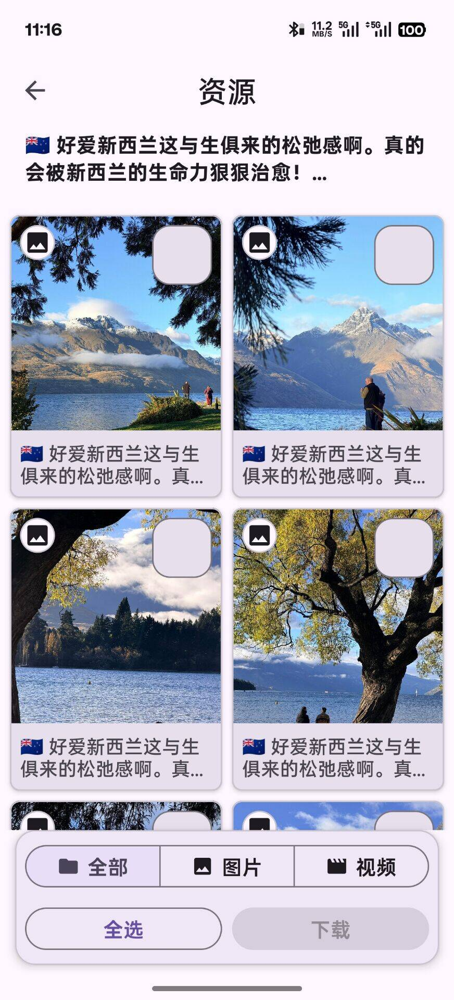
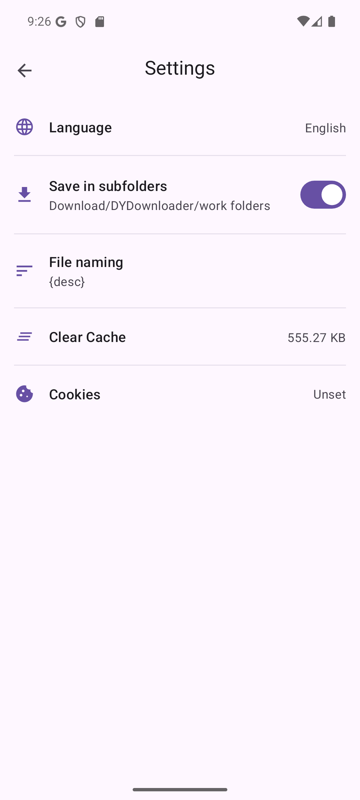

# DYDownloader

<p align="center">
  
</p>

<p align="center">
  <a href="https://github.com/halcyra/DYDownloader/releases"></a>
  <a href="app/build.gradle.kts"></a>
  <a href="LICENSE"></a>
</p>

[简体中文](README.md)

An open-source, free and local Android app for downloading watermark-free Douyin/TikTok original images, albums, live photos, videos, account posts, and collection posts.

Local parsing, direct platform requests, and custom file naming. No third-party parsing service required.

<p align="center">
  <a href="https://github.com/halcyra/DYDownloader/releases"></a>
</p>

## Usage

1. Download and install the APK.
2. Sign in to Douyin/TikTok under Settings → Cookies as needed.
3. Paste a shared link to a post, account, or collection, then parse, select, and download.

Cookies stay on your device and are only sent to the corresponding platform. Downloads are saved locally.

## Screenshots

<p align="center">
  
  
  
</p>

## Build

Use JDK 21 and Android SDK 36:

```sh
./gradlew :app:testDebugUnitTest :app:assembleDebug
```

On Windows, use `gradlew.bat`. The APK is written to `app/build/outputs/apk/debug/`.

## License

[GPL-3.0](LICENSE). For learning and lawful personal use. Respect copyright and platform rules.
