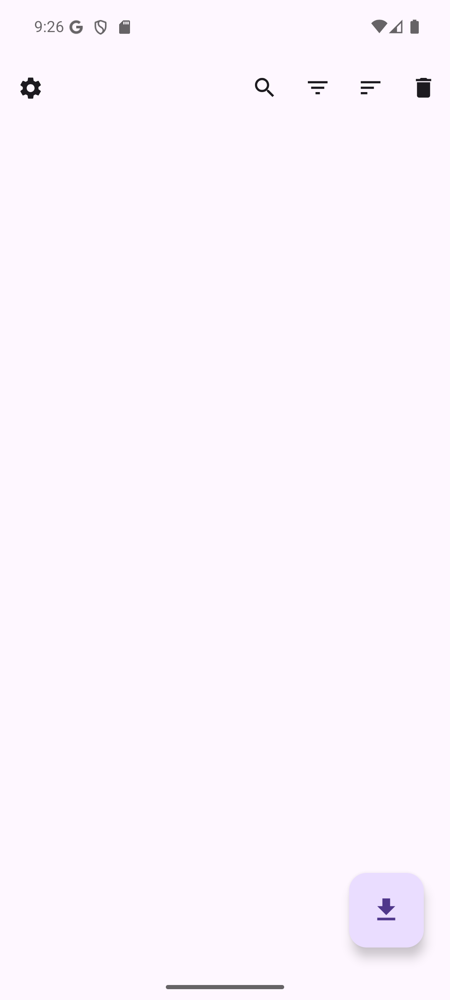
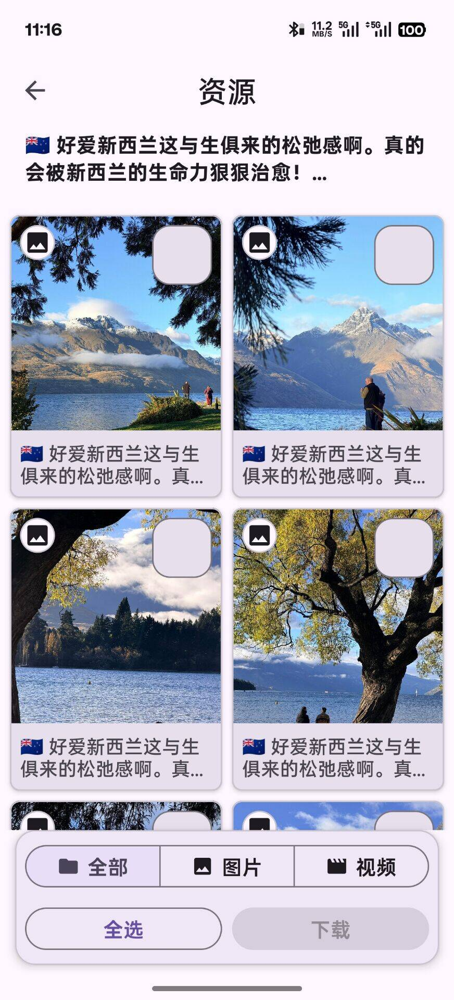
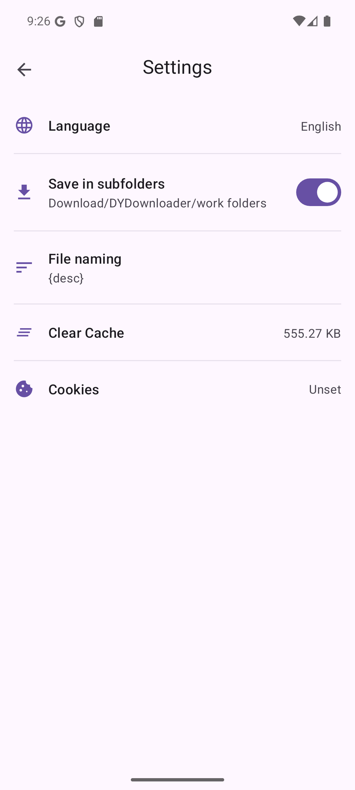

# DYDownloader

<p align="center">
  
</p>

<p align="center">
  <a href="https://github.com/halcyra/DYDownloader/releases"></a>
  <a href="app/build.gradle.kts"></a>
  <a href="LICENSE"></a>
</p>

[English](README.en.md)

一个开源免费本地的抖音/TikTok 无水印原图/图集/动图/视频/账号/合集下载工具/安卓APP。

本地解析并直接请求平台接口，支持自定义文件命名，无需第三方解析服务。

<p align="center">
  <a href="https://github.com/halcyra/DYDownloader/releases"></a>
</p>

## 使用

1. 下载并安装 APK。
2. 按需在「设置 → Cookies」中登录抖音/TikTok。
3. 粘贴作品、账号或合集的分享链接，解析后选择资源并下载。

Cookies 仅保存在设备本地，仅用于对应平台请求。下载内容保存在本地设备。

## 截图

<p align="center">
  
  
  
</p>

## 构建

使用 JDK 21 和 Android SDK 36：

```sh
./gradlew :app:testDebugUnitTest :app:assembleDebug
```

Windows 使用 `gradlew.bat`。APK 输出至 `app/build/outputs/apk/debug/`。

## 许可

[GPL-3.0](LICENSE)。仅供学习与合法个人使用，请尊重版权和平台规则。
